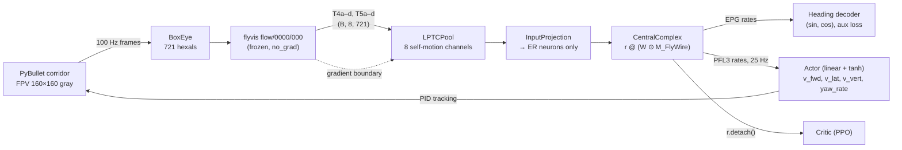

# Fly-By-Wire

A simulated quadcopter that steers down an obstacle corridor using a frozen, connectome-constrained
model of the fly optic lobe feeding a recurrent network wired like the FlyWire central complex.

<!-- Demo: lesion video (scripts/render_lesion_video.py) goes here once available, e.g.
<p align="center"></p> -->

> **Status:** env, DART expert data, BC + DAgger, real-vs-rewired sweeps and time-freeze pause training are done. Gates 1 and 2 pass; Gate 3 fails (bump share at most 0.36 against 0.5). PPO, dashboard and video are stubs.
> PPO, dashboard and video are stubs; nothing has been trained yet.

## What is reused vs. built

**Reused (frozen dependency).** The optic-lobe model is [flyvis](https://github.com/TuragaLab/flyvis)
(Lappalainen et al., *Nature* 2024), pretrained model `flow/0000/000`, used as-is with no gradients.
Physics and the quadcopter model come from gym-pybullet-drones (Panerati et al., IROS 2021).

**Built in this repo.**

- an **LPTC bridge** that pools T4/T5 direction-selective outputs into 8 self-motion channels with
  fixed ego-motion flow templates and calibrated preferred directions;
- a **FlyWire-masked recurrent central complex** (ER, EPG, PEN, PEG, Δ7, PFL3): one rate population
  whose only neuron-to-neuron path is the connectome mask;
- **BC → PPO training** (behavior cloning from a scripted expert, then PPO with a KL anchor);
- **lesioning** of cell types at inference time;
- a **null-model comparison**: real connectome vs. a directed degree-preserving rewire (3 seeds each).

## Architecture



Fallback vision backend (`vision.backend: farneback`): OpenCV Farneback optical flow projected
onto the same 8 templates, producing `(B, 8)` directly.

### Clocks

| Layer | Rate | Steps per decision |
|---|---|---|
| PyBullet physics | 200 Hz | 8 |
| Render + flyvis (`dt = 1/100`) + CX core | 100 Hz | 4 |
| Actor readout | 25 Hz | 1 |

Decision `k` is read out after core step `4k + 3`; its action is held for the next 8 physics steps.
An episode of `K` decisions has exactly `4K` frames (a 4-frame hover pre-roll feeds decision 0).
This alignment is defined once, in `flybywire/clocks.py`.

### Core equations

```
r_t      = phi(v_t) * keep                 # keep: (N,) lesion mask, default all ones
drive_t  = r_t @ (W * M) + u_t + b         # M[i, j] = 1 iff presynaptic i -> postsynaptic j
v_{t+1}  = (1 - alpha) * v_t + alpha * drive_t
alpha    = sigmoid(a)                      # per neuron; alpha = dt / tau, init 0.2 (tau ≈ 50 ms)
```

`phi` = softplus (relu optional). `W` is dense `(N, N)` times a boolean buffer `M`; its gradient is
exactly zero off the mask. There is no residual stream and no LayerNorm, so lesions really silence
neurons and nothing mixes neurons outside the connectome. fp32 everywhere.

## Install

```bash
make env          # = bash scripts/setup_env.sh  (conda env "flybywire")
conda activate flybywire
make check        # preflight table: GPU, CUDA arch, flyvis models, EGL rendering, ...
```

`setup_env.sh` installs in a fixed order: conda env (Python 3.12) → PyTorch from the CUDA wheel index
(`cu130` by default; override with `TORCH_INDEX=...`) → flyvis (then verifies torch was not
replaced) → gym-pybullet-drones from GitHub (dry-run first; `--no-deps` if it would replace
anything) → `requirements.txt` → `pip install -e .` → flyvis pretrained models → `requirements.lock.txt`.

- **GPU:** Blackwell cards (RTX 50xx, compute capability 12.0 / `sm_120`) need PyTorch wheels built
  with **CUDA ≥ 12.8**. Older wheels install fine and then fail at the first kernel launch.
  `make check` verifies `sm_120` is in `torch.cuda.get_arch_list()`.
- **Python 3.12** is required: current gym-pybullet-drones needs ≥ 3.12 and flyvis needs < 3.13
  (see `docs/DECISIONS.md`, D8).
- **WSL:** keep the repo on the Linux filesystem (`~/...`), never under `/mnt/c`. If WSL has
  less than ~23 GB of memory, add this to `%UserProfile%\.wslconfig` and run `wsl --shutdown`:

  ```ini
  [wsl2]
  memory=24GB
  swap=8GB
  ```

  The WSL virtual disk lives on C: by default.
- System packages: an NVIDIA driver plus `libgl1`, `libegl1` and `libglib2.0-0` (for EGL rendering
  and OpenCV). If one is missing, install it with `sudo apt install <package>`. pybullet 3.2.7 has no
  Python 3.12 wheel and builds from source, so a C++ toolchain (`build-essential`) must be present.

## Data

All data lives under `data/` (git-ignored; see `data/README.md`). `.env` sets
`FLYVIS_ROOT_DIR=./data/flyvis` and `FBW_DATA_DIR=./data`.

**flyvis pretrained models** (done by `make env`):

```bash
FLYVIS_ROOT_DIR=$PWD/data/flyvis flyvis download-pretrained --skip_large_files
```

**FlyWire central-complex tables (manual).** Data from FlyWire (Dorkenwald et al., 2024; Schlegel et
al., 2024). Downloading may require signing in to FlyWire Codex and accepting its terms of use.

1. Go to [FlyWire Codex](https://codex.flywire.ai) → *Download data*, and select **snapshot 783**.
2. Download the **connections** table (pre/post root ids, neuropil, synapse count). The loader sums
   synapses across neuropils *before* applying `min_synapses` (5), so prefer an unthresholded
   variant if one is offered.
3. Download the **cell-type annotation** table (root id → cell type), and optionally the **names**
   table (root id → name).
4. Put the files in `data/flywire/raw/`. The default expected names and columns are under
   `connectome.flywire` in `configs/default.yaml`. **Verify them against your files.** On a
   mismatch the loader prints the columns it found and stops.
5. `python -m flybywire.connectome.flywire` prints the matched types, N, edge count and density,
   and writes `data/flywire/processed/cx_graph.npz`, which the model, tests and smoke run load.

**Storage budget**

| Item | Size |
|---|---|
| conda env | 8–12 GB |
| flyvis pretrained models | 10 MB download (measured); 111 MB after first use (flyvis builds a 101 MB connectome cache) |
| FlyWire tables | up to ~2 GB |
| expert trajectories (300 × hexals fp16) | 127 MB measured (+ 18 MB raw frames for 20 episodes) |
| T4/T5 cache (300 × 1000 × 8 × 721 fp16) | 3.46 GB measured |
| logs, checkpoints, videos | 2–5 GB |
| **total** | **~20–30 GB; keep 50 GB free** |

## Quickstart

```bash
make check       # environment table
make test        # pytest; GPU, flyvis and FlyWire-graph tests skip with a reason when unavailable
make smoke       # end-to-end plumbing run on synthetic trajectories + the FlyWire graph (~20 s). NOT a result.
make gate1       # flyvis state-carry equivalence + throughput -> runs/gate1/report.json
make calibrate   # T4/T5 preferred directions -> data/flyvis/direction_map.json
make collect     # 300 scripted-expert episodes -> data/expert (hexals, actions, state; ~7 min)
make cache       # frozen flyvis over the stored hexals -> data/cache T4/T5 memmap (3.5 GB, ~1 min)
make gate2       # ridge T4/T5 -> yaw rate on held-out trajectories -> runs/gate2/report.json
make params      # effective trainable parameters (W counted on-mask only)
```

## Gates

| Gate | Question | Pass criterion | Status |
|---|---|---|---|
| 1 | Can frozen flyvis be stepped frame by frame with carried state, fast enough? | (a) one call vs. (b) per-frame with state agree to ≤ 1e-5 relative, **and** ≥ 100 batched steps/s at B = 12 | **PASS** (2.7e-7; 634 steps/s) |
| 2 | Is yaw rate linearly decodable from T4/T5 in the corridor? | ridge regression T4/T5 → yaw rate on held-out trajectories, R² > 0.5 | **PASS** (test R² 0.787, 60 held-out episodes) |
| 3 | Does the trained core carry heading in EPG? | heading decode from EPG R² > 0.8 **and** the ring shows a single bump rotating with yaw (anatomical EB layout: first-harmonic share > 0.5, bump-heading alignment > 0.8) | **FAIL** (R² 0.97 and alignment 0.98 pass with the anatomical readout; bump share at most 0.45) |

## Repo layout

```
configs/default.yaml        single source of truth (clocks, vision, connectome, core, BC, PPO, sweep)
flybywire/
  config.py, clocks.py      config load/validation; the one definition of decision timing
  paths.py                  safe flyvis import (absolute root dir, default-device fix)
  connectome/               FlyWire loader, masks (real / rewire / er), directed rewire
  vision/                   BoxEye, frozen flyvis stepper, flow templates, LPTC, directions, Farneback
  core/                     CentralComplex population, heads, lesions, model wiring
  data/                     trajectory format, T4/T5 memmap cache
  train/                    bc.py (implemented), ppo.py (stub), sweep.py
  eval/                     heading metrics, EPG ring layouts + plot
  envs/                     PyBullet corridor env, scripted expert, vec env (spawned workers)
  dash/                     dashboard (stub)
scripts/                    check_env, setup_env, gate1, calibrate, collect_expert, build_cache, gate2,
                            count_params, smoke, stubs
tests/                      invariants 1–10 and component tests
docs/DECISIONS.md           dated decisions and every deviation from the spec
```

## Results

Latest: BC on 1000 turning-expert episodes with DART execution noise plus two DAgger rounds (1600
episodes), scored on 100 held-out episodes; mean ± sd over seeds (D38). "learned" is the free
2 × 51 heading readout, "anatomical" the fixed population vector over EPG EB angles. Bump share is
on the anatomical ring (0.5 ≈ a 53° FWHM bump, 0.3 ≈ 30°). Closed loop: 200 held-out episodes per
seed, seeds 0-2; the expert flies 100%.

| Mask / readout | Seeds | Heading R² | Bump share | Closed-loop success [95% CI] |
|---|---|---|---|---|
| real / learned | 0-2 | 0.907 | 0.14 ± 0.06 | 65.8% [61.9, 69.5] |
| rewire / learned | 0-2 | 0.919 | 0.17 ± 0.04 | 87.0% [84.1, 89.5] |
| real / anatomical | 0-5 | 0.920 | 0.32 ± 0.04 | 68.8% [65.0, 72.4] |
| rewire / anatomical | 0-5 | 0.923 | 0.32 ± 0.05 | 80.2% [76.8, 83.2] |

Real and rewired wiring give the same bump share (p 0.998, protocol in
`docs/protocols/sweep_dart_agg2.md`); an earlier real > rewired lead (D35) did not replicate (D36,
D38). No run reaches Gate 3's 0.5. The rewired mask flies better (post hoc, p 0.015). Training
with time-freeze pauses (D39) roughly halves heading drift through 1-2 s of no visual motion,
with real and rewired again indistinguishable.

Figures (placeholders): real vs. rewired adjacency; ring bump vs. heading; heading decode per
condition; lesion effects; BC → PPO success rate.

## Lesion demo

Programmatic API (works now):

```python
from flybywire.config import load_config
from flybywire.core.model import build_model
from flybywire.core.lesion import lesioned

model = build_model(load_config())   # needs data/flyvis/direction_map.json (make calibrate)
model.lesion(["EPG"])                 # EPG rates are exactly 0 from the next step on
model.restore()
with lesioned(model, ["PEN"]):        # scoped lesion
    ...
```

Demo video (once the env and a trained policy exist):

```bash
python scripts/render_lesion_video.py --checkpoint runs/<run>/model.pt --out demo.mp4
streamlit run flybywire/dash/app.py   # live dashboard (stub)
```

## Acknowledgements and citations

- flyvis: Lappalainen, J. K., et al. (2024). Connectome-constrained networks predict neural activity
  across the fly visual system. *Nature*.
- FlyWire: Dorkenwald, S., et al. (2024). Neuronal wiring diagram of an adult brain. *Nature*;
  Schlegel, P., et al. (2024). Whole-brain annotation and multi-connectome cell typing of
  Drosophila. *Nature*.
- Central complex: Hulse, B. K., et al. (2021). *eLife*; Seelig, J. D., & Jayaraman, V. (2015).
  *Nature*; Turner-Evans, D., et al. (2017). *eLife*; Green, J., et al. (2017). *Nature*;
  Westeinde, E. A., et al. (2024). *Nature*.
- Self-motion flow templates and LPTCs: Krapp, H. G., & Hengstenberg, R. (1996). *Nature*;
  Longuet-Higgins, H. C., & Prazdny, K. (1980). *Proc. R. Soc. Lond. B*.
- gym-pybullet-drones: Panerati, J., et al. (2021). IROS.
- PPO: Schulman, J., et al. (2017). arXiv.

## License

MIT. See `LICENSE`.
