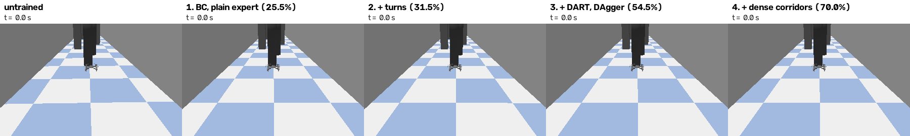
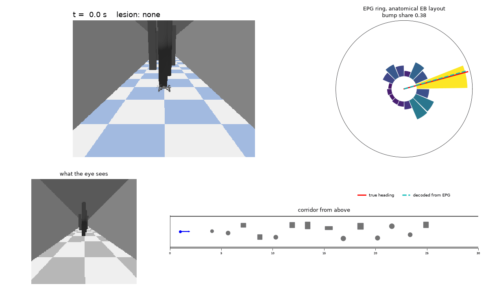
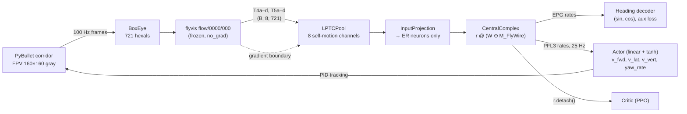

# Fly-By-Wire

A simulated quadcopter that steers down an obstacle corridor using a frozen, connectome-constrained
model of the fly optic lobe feeding a recurrent network wired like the FlyWire central complex.

<p align="center"></p>

*One network per training stage, each flying the same held-out slalom corridor (1.6 m obstacle
spacing). Labels give each stage's success over 200 held-out slalom corridors; this corridor was
picked as the first where the last stage makes it and the one before does not.*

<p align="center"></p>

*The final network flying a slalom corridor: chase camera, what its eye sees, the corridor from
above and the EPG ring on the anatomical ellipsoid-body layout, with the true and decoded heading
drawn in the ring's frame. EPG is silenced from 6 s: the bump is gone, steering stops responding
and the drone turns into an obstacle.*

> **Status:** done. Env, DART expert data, BC + DAgger, real-vs-rewired sweeps, time-freeze pause
> training, closed-loop lesions, PPO and a final dense-corridor stage. Gates 1 and 2 pass; Gate 3
> fails (bump share at most 0.36 on the final data, against 0.5). Across every pre-registered test
> the FlyWire wiring did not beat a degree-preserving rewire. PPO did not improve on BC.

## What is reused vs. built

**Reused (frozen dependency).** The optic-lobe model is [flyvis](https://github.com/TuragaLab/flyvis)
(Lappalainen et al., *Nature* 2024), pretrained model `flow/0000/000`, used as-is with no gradients.
Physics and the quadcopter model come from gym-pybullet-drones (Panerati et al., IROS 2021).

**Built in this repo.**

- an **LPTC bridge** that pools T4/T5 direction-selective outputs into 8 self-motion channels with
  fixed ego-motion flow templates and calibrated preferred directions;
- a **FlyWire-masked recurrent central complex** (ER, EPG, PEN, PEG, Δ7, PFL3): one rate population
  whose only neuron-to-neuron path is the connectome mask;
- **staged training**: behavior cloning from a scripted expert (plain, then turning maneuvers,
  then DART noise and DAgger), PPO fine-tuning with a KL anchor to the BC policy, and a last BC
  stage on denser corridors;
- **lesioning** of cell types at inference time;
- a **null-model comparison**: real connectome vs. a directed degree-preserving rewire, with
  protocols written before training (10 seeds per mask on the turning data, 6 on the DART data,
  6 on the uniform-hold data);
- a **live training window** and a **dashboard** with lesion toggles.

## Architecture



Fallback vision backend (`vision.backend: farneback`): OpenCV Farneback optical flow projected
onto the same 8 templates, producing `(B, 8)` directly.

### Clocks

| Layer | Rate | Steps per decision |
|---|---|---|
| PyBullet physics | 200 Hz | 8 |
| Render + flyvis (`dt = 1/100`) + CX core | 100 Hz | 4 |
| Actor readout | 25 Hz | 1 |

Decision `k` is read out after core step `4k + 3`; its action is held for the next 8 physics steps.
An episode of `K` decisions has exactly `4K` frames (a 4-frame hover pre-roll feeds decision 0).
This alignment is defined once, in `flybywire/clocks.py`.

### Core equations

```
r_t      = phi(v_t) * keep                 # keep: (N,) lesion mask, default all ones
drive_t  = r_t @ (W * M) + u_t + b         # M[i, j] = 1 iff presynaptic i -> postsynaptic j
v_{t+1}  = (1 - alpha) * v_t + alpha * drive_t
alpha    = sigmoid(a)                      # per neuron; alpha = dt / tau, init 0.2 (tau ≈ 50 ms)
```

`phi` = softplus (relu optional). `W` is dense `(N, N)` times a boolean buffer `M`; its gradient is
exactly zero off the mask. There is no residual stream and no LayerNorm, so lesions really silence
neurons and nothing mixes neurons outside the connectome. fp32 everywhere.

## Install

```bash
make env          # = bash scripts/setup_env.sh  (conda env "flybywire")
conda activate flybywire
make check        # preflight table: GPU, CUDA arch, flyvis models, EGL rendering, ...
```

`setup_env.sh` installs in a fixed order: conda env (Python 3.12) → PyTorch from the CUDA wheel index
(`cu130` by default; override with `TORCH_INDEX=...`) → flyvis (then verifies torch was not
replaced) → gym-pybullet-drones from GitHub (dry-run first; `--no-deps` if it would replace
anything) → `requirements.txt` → `pip install -e .` → flyvis pretrained models → `requirements.lock.txt`.

- **GPU:** Blackwell cards (RTX 50xx, compute capability 12.0 / `sm_120`) need PyTorch wheels built
  with **CUDA ≥ 12.8**. Older wheels install fine and then fail at the first kernel launch.
  `make check` verifies `sm_120` is in `torch.cuda.get_arch_list()`.
- **Python 3.12** is required: current gym-pybullet-drones needs ≥ 3.12 and flyvis needs < 3.13
  (see `docs/DECISIONS.md`, D8).
- **WSL:** keep the repo on the Linux filesystem (`~/...`), never under `/mnt/c`. If WSL has
  less than ~23 GB of memory, add this to `%UserProfile%\.wslconfig` and run `wsl --shutdown`:

  ```ini
  [wsl2]
  memory=24GB
  swap=8GB
  ```

  The WSL virtual disk lives on C: by default.
- System packages: an NVIDIA driver plus `libgl1`, `libegl1` and `libglib2.0-0` (for EGL rendering
  and OpenCV). If one is missing, install it with `sudo apt install <package>`. pybullet 3.2.7 has no
  Python 3.12 wheel and builds from source, so a C++ toolchain (`build-essential`) must be present.

## Data

All data lives under `data/` (git-ignored; see `data/README.md`). `.env` sets
`FLYVIS_ROOT_DIR=./data/flyvis` and `FBW_DATA_DIR=./data`.

**flyvis pretrained models** (done by `make env`):

```bash
FLYVIS_ROOT_DIR=$PWD/data/flyvis flyvis download-pretrained --skip_large_files
```

**FlyWire central-complex tables (manual).** Data from FlyWire (Dorkenwald et al., 2024; Schlegel et
al., 2024). Downloading may require signing in to FlyWire Codex and accepting its terms of use.

1. Go to [FlyWire Codex](https://codex.flywire.ai) → *Download data*, and select **snapshot 783**.
2. Download the **connections** table (pre/post root ids, neuropil, synapse count). The loader sums
   synapses across neuropils *before* applying `min_synapses` (5), so prefer an unthresholded
   variant if one is offered.
3. Download the **cell-type annotation** table (root id → cell type), and optionally the **names**
   table (root id → name).
4. Put the files in `data/flywire/raw/`. The default expected names and columns are under
   `connectome.flywire` in `configs/default.yaml`. **Verify them against your files.** On a
   mismatch the loader prints the columns it found and stops.
5. `python -m flybywire.connectome.flywire` prints the matched types, N, edge count and density,
   and writes `data/flywire/processed/cx_graph.npz`, which the model, tests and smoke run load.

**Storage budget**

| Item | Size |
|---|---|
| conda env | 8–12 GB |
| flyvis pretrained models | 10 MB download (measured); 111 MB after first use (flyvis builds a 101 MB connectome cache) |
| FlyWire tables | up to ~2 GB |
| expert trajectories (hexals fp16) | 427 MB for 1000 DART episodes + 210 MB for 600 DAgger episodes, measured |
| T4/T5 cache (1600 episodes × 1000 × 8 × 721 fp16) | 17 GB measured (`data/cache_dart_agg2`); 1.1 GB per 100-episode test cache |
| pause bank (4000 held-frame entries) | ~6 GB |
| logs, checkpoints, videos | 2–5 GB |
| **total** | **~40–50 GB; keep 50 GB free** |

Caches and pause banks are rebuilt from the stored hexals (`scripts/build_cache.py`,
`scripts/build_pause_bank.py`), so superseded ones can be deleted.

## Quickstart

```bash
make check       # environment table
make test        # pytest; GPU, flyvis and FlyWire-graph tests skip with a reason when unavailable
make smoke       # end-to-end plumbing run on synthetic trajectories + the FlyWire graph (~20 s). NOT a result.
make gate1       # flyvis state-carry equivalence + throughput -> runs/gate1/report.json
make calibrate   # T4/T5 preferred directions -> data/flyvis/direction_map.json
make collect     # 300 scripted-expert episodes -> data/expert (hexals, actions, state; ~7 min)
make cache       # frozen flyvis over the stored hexals -> data/cache T4/T5 memmap (3.5 GB, ~1 min)
make gate2       # ridge T4/T5 -> yaw rate on held-out trajectories -> runs/gate2/report.json
make params      # effective trainable parameters (W counted on-mask only)

python -m flybywire.train.bc --cache data/cache_dart_agg2 --out runs/bc/demo heads.decoder=anatomical
python -m flybywire.train.ppo --bc runs/bc/demo/model_best.pt --out runs/ppo/demo --watch --record-every 50
python scripts/eval_curriculum.py --ckpts "demo=runs/bc/demo/model_best.pt"   # success per corridor level
python scripts/eval_lesions.py --ckpt runs/bc/demo/model_best.pt              # EPG / PEN / D7 in closed loop
```

`--watch` opens one window on a training env: a chase camera, the eye's view, the corridor from
above, the EPG ring and the training curves. `--record-every N` saves that window as a video for one
episode every N updates (`<out>/watch/`). Recording stops once that folder holds `--record-budget-gb`
(default 2) or the disk has under 10 GB free.

## Gates

| Gate | Question | Pass criterion | Status |
|---|---|---|---|
| 1 | Can frozen flyvis be stepped frame by frame with carried state, fast enough? | (a) one call vs. (b) per-frame with state agree to ≤ 1e-5 relative, **and** ≥ 100 batched steps/s at B = 12 | **PASS** (2.7e-7; 634 steps/s) |
| 2 | Is yaw rate linearly decodable from T4/T5 in the corridor? | ridge regression T4/T5 → yaw rate on held-out trajectories, R² > 0.5 | **PASS** (test R² 0.787, 60 held-out episodes) |
| 3 | Does the trained core carry heading in EPG? | heading decode from EPG R² > 0.8 **and** the ring shows a single bump rotating with yaw (anatomical EB layout: first-harmonic share > 0.5, bump-heading alignment > 0.8) | **FAIL** (R² and alignment pass with the anatomical readout; best bump share 0.45 on the pre-DART turning data, 0.36 on the final DART data) |

## Repo layout

```
configs/default.yaml        single source of truth (clocks, vision, connectome, core, BC, PPO, sweep)
flybywire/
  config.py, clocks.py      config load/validation; the one definition of decision timing
  paths.py                  safe flyvis import (absolute root dir, default-device fix)
  connectome/               FlyWire loader, masks (real / rewire / er), directed rewire
  vision/                   BoxEye, frozen flyvis stepper, flow templates, LPTC, directions, Farneback
  core/                     CentralComplex population, heads, lesions, model wiring
  data/                     trajectory format, T4/T5 memmap cache
  train/                    bc.py, ppo.py, sweep.py, watch.py (live training window)
  eval/                     closed loop, heading metrics, EPG ring, topography, darkness, live flight views
  envs/                     PyBullet corridor env, scripted expert, vec env (spawned workers)
  dash/                     Streamlit dashboard with lesion toggles
scripts/                    data and gates, evaluations, sweep statistics, lesion video, progress GIF
tests/                      invariants 1–10 and component tests
docs/DECISIONS.md           dated decisions and every deviation from the spec
```

## Results

**Real vs. rewired on the DART data (D38).** BC on 1000 turning-expert episodes with DART execution noise plus two DAgger rounds (1600
episodes), scored on 100 held-out episodes; mean ± sd over seeds (D38). "learned" is the free
2 × 51 heading readout, "anatomical" the fixed population vector over EPG EB angles. Bump share is
on the anatomical ring (0.5 ≈ a 53° FWHM bump, 0.3 ≈ 30°). Closed loop: seeds 0-2 of each
condition, 200 held-out episodes per run; the expert flies 100%. The seed is the unit: the
interval is the t interval over the three per-seed rates (n = 3, so it is wide; capped at 100%), not a binomial
interval over 600 episodes, which would ignore the spread between seeds.

| Mask / readout | Seeds | Heading R² | Bump share | Closed loop per seed (s0, s1, s2) | Mean [95% CI over seeds] |
|---|---|---|---|---|---|
| real / learned | 0-2 | 0.907 | 0.14 ± 0.06 | 76.0, 45.0, 76.5% | 65.8% [21, 100] |
| rewire / learned | 0-2 | 0.919 | 0.17 ± 0.04 | 83.0, 88.5, 89.5% | 87.0% [78, 96] |
| real / anatomical | 0-5 | 0.920 | 0.32 ± 0.04 | 61.0, 78.5, 67.0% | 68.8% [47, 91] |
| rewire / anatomical | 0-5 | 0.923 | 0.32 ± 0.05 | 75.0, 87.0, 78.5% | 80.2% [65, 96] |

Real / anatomical seeds 3-5 were also flown (73.0, 59.0, 79.5%). Real and rewired wiring give the
same bump share (p 0.998, protocol in `docs/protocols/sweep_dart_agg2.md`); an earlier real >
rewired lead (D35) did not replicate (D36, D38). No run reaches Gate 3's 0.5. The rewired mask
flies better: 83.6% vs 67.3% over the six closed-loop runs per mask, exact permutation test with
the run as the unit (mask labels shuffled within readout, 400 relabelings) p 0.015. That test was
chosen after seeing the data, so it is a lead to replicate, not a finding. Training
with time-freeze pauses (D39) roughly halves heading drift through 1-2 s of no visual motion,
with real and rewired again indistinguishable.

**Uniform holding headings (D42).** The expert's turns now end at headings drawn from the whole
circle, to test whether the stable headings near 0 and ±85° came from where the old expert rested,
and whether wiring matters once a heading must be held anywhere. Pre-registered in
`docs/protocols/sweep_uniform_pauses.md`, 18 runs. The velocity field is a little flatter (p 0.074)
but the stable points stay (±85° in 8 of 12 runs); real vs. rewired: drift p 0.55, field rms
p 0.26, bump share p 0.996; rewired flies better again (82.9% vs 64.3%) but p 0.119. Over three
datasets the FlyWire mask did not beat the rewire on any pre-registered measure.

**PPO (D43).** Three setups (crash penalty, exploration noise, rollout length, checkpoint picked on
separate validation corridors) all left the deterministic policy at or below BC: best 75.0% on the
test corridors against BC's 79.5%. PPO improved the noisy training policy, not its mean.

**Dense-corridor stage (D44).** A last BC stage on corridors with obstacles every 2.5, 2.0 and
1.6 m, from the stage-3 network, with the original data replayed. Success on 200 held-out
corridors per level [Wilson 95%]:

| Network | default | spaced 2.5 m | dense 2.0 m | slalom 1.6 m |
|---|---|---|---|---|
| scripted expert | 100 | 96.5 | 99.0 | 98.0 |
| untrained | 0 | | | 0 |
| 1. BC, plain expert | 53.5 | | | 25.5 |
| 2. BC, turning expert | 59.0 | | | 31.5 |
| 3. BC, DART + DAgger | 79.5 [73.4, 84.5] | 65.5 | 58.0 | 54.5 [47.6, 61.3] |
| 4. + dense corridors | 80.5 [74.5, 85.4] | 67.5 | 65.0 | 70.0 [63.3, 75.9] |

**Lesions in closed loop (D41, D44).** Cell types silenced for the whole flight, 200 held-out
default corridors; "gain" is how far the bump turns per degree the drone turns.

| Lesion | stage 3: success | heading err | gain | stage 4: success | heading err | gain |
|---|---|---|---|---|---|---|
| none | 79.5% | 5.8° | 1.12 | 80.5% | 4.4° | 1.01 |
| EPG | 0% | 59.7° | 0 | 0% | 70.0° | 0 |
| PEN | 82.5% | 11.0° | 1.23 | 65.0% | 21.9° | 0.71 |
| Δ7 | 5.0% | 6.7° | 0.81 | 3.5% | 7.7° | 0.71 |

Silencing EPG removes the bump and the drone's steering with it: the actor reads only PFL3, and
PFL3 is driven through EPG, so flight depends on the compass. Silencing PEN does not freeze the
compass in either network (self-motion reaches EPG through ER all the time), but after the dense
stage the bump follows turns less well and success falls. Δ7 matters for the motor side, not the
ring: the compass holds and the drone flies too fast and crashes.

## Lesion demo

Programmatic API:

```python
from flybywire.config import load_config
from flybywire.core.model import build_model
from flybywire.core.lesion import lesioned

model = build_model(load_config())   # needs data/flyvis/direction_map.json (make calibrate)
model.lesion(["EPG"])                 # EPG rates are exactly 0 from the next step on
model.restore()
with lesioned(model, ["PEN"]):        # scoped lesion
    ...
```

Videos and the dashboard:

```bash
# the dashboard GIF above: lesions on a schedule, any corridor level
python scripts/render_lesion_video.py --ckpt runs/curriculum/dense_s5/model.pt --out docs/media/dashboard.mp4 \
    --gif docs/media/dashboard.gif --seed 10001 --seconds 12 env.obstacle_spacing_m=1.6 env.n_obstacles=14 \
    --schedule EPG:6-12
# the progress GIF: one tile per training stage on the same corridor
python scripts/render_progress.py --out docs/media/progress.gif --seed 10001 --seconds 12 \
    env.obstacle_spacing_m=1.6 env.n_obstacles=14 --stages "stage 3=runs/sweep_dart/real_anatomical_s5/model_best.pt" ...
# fly a policy live and toggle lesions while it flies
streamlit run flybywire/dash/app.py -- --ckpt runs/curriculum/dense_s5/model.pt
```

## Acknowledgements and citations

- flyvis: Lappalainen, J. K., et al. (2024). Connectome-constrained networks predict neural activity
  across the fly visual system. *Nature*.
- FlyWire: Dorkenwald, S., et al. (2024). Neuronal wiring diagram of an adult brain. *Nature*;
  Schlegel, P., et al. (2024). Whole-brain annotation and multi-connectome cell typing of
  Drosophila. *Nature*.
- Central complex: Hulse, B. K., et al. (2021). *eLife*; Seelig, J. D., & Jayaraman, V. (2015).
  *Nature*; Turner-Evans, D., et al. (2017). *eLife*; Green, J., et al. (2017). *Nature*;
  Westeinde, E. A., et al. (2024). *Nature*.
- Self-motion flow templates and LPTCs: Krapp, H. G., & Hengstenberg, R. (1996). *Nature*;
  Longuet-Higgins, H. C., & Prazdny, K. (1980). *Proc. R. Soc. Lond. B*.
- gym-pybullet-drones: Panerati, J., et al. (2021). IROS.
- PPO: Schulman, J., et al. (2017). arXiv.

## License

MIT. See `LICENSE`.
# FlyByWire
