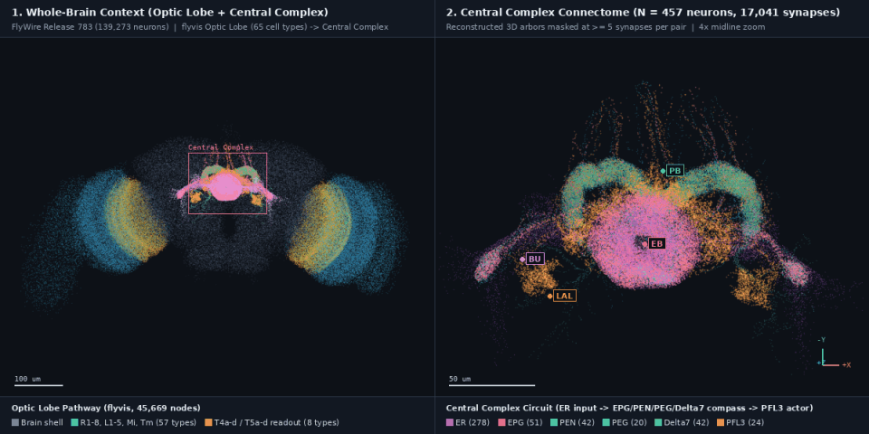
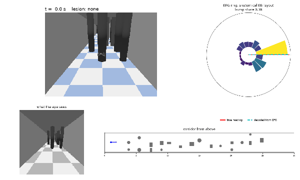
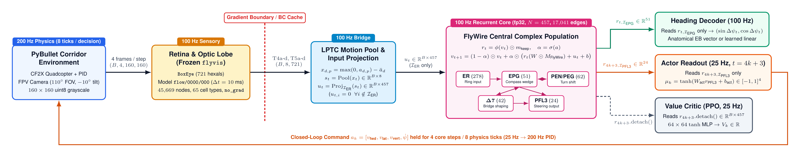

# Fly-By-Wire

[](environment.yml)
[](scripts/setup_env.sh)
[](https://www.nature.com/articles/s41586-024-07939-3)
[-db2777.svg>)](https://www.nature.com/articles/s41586-024-07558-y)
[](flybywire/envs/corridor.py)
[](flybywire/train/ppo.py)
[](LICENSE)

**Connectome-constrained visual flight control coupling a frozen _Drosophila_ optic-lobe network (`flyvis`) to a recurrent central-complex circuit wired from the FlyWire adult brain connectome.**

<p align="center">
  
</p>

_Figure 1. Three-dimensional reconstruction from FlyWire release 783 (`sk_lod1_783_healed_ds2.parquet`) showing the two neural systems coupled in this repository. Left panel displays the whole adult brain (139,273 neurons) with the frozen `flyvis` optic-lobe pathway (57 upstream retinotopic cell types in cyan and 8 direction-selective T4a-d / T5a-d output types in gold) feeding the midline central complex. Right panel shows a 4x midline zoom of all 457 reconstructed central-complex skeletons (17,041 directed edges thresholded at $\ge 5$ synapses) across the protocerebral bridge (PB), ellipsoid body (EB), lateral bulbs (BU), and lateral accessory lobe (LAL)._

---

## Abstract

Fly-By-Wire is a closed-loop sensorimotor control system in which a simulated Crazyflie 2.x quadcopter navigates obstacle corridors using two biologically constrained neural stages. First-person grayscale video frames rendered at $100\text{ Hz}$ pass through a hexagonal retinal filter (`BoxEye`, $721$ ommatidia) into a frozen, pretrained connectome model of the _Drosophila_ optic lobe (`flyvis` model `flow/0000/000`, comprising $45{,}669$ neurons across $65$ cell types). Direction-selective ON ($\mathrm{T4a\text{-}d}$) and OFF ($\mathrm{T5a\text{-}d}$) motion detector voltages are rectified, baseline-subtracted, and pooled through lobula plate tangential cell (LPTC) flow templates into $8$ self-motion channels. These channels drive ellipsoid-body ring neurons ($\mathrm{ER}$) inside a single recurrent rate population of $N = 457$ neurons whose synaptic weight matrix is masked by the directed adjacency matrix of the FlyWire central complex ($\mathrm{ER}$, $\mathrm{EPG}$, $\mathrm{PEN}$, $\mathrm{PEG}$, $\Delta 7$, and $\mathrm{PFL3}$). Heading is decoded at $100\text{ Hz}$ exclusively from $\mathrm{EPG}$ compass wedge neurons, and body-frame flight commands $[v_{\text{fwd}}, v_{\text{lat}}, v_{\text{vert}}, \dot{\psi}]$ are read out at $25\text{ Hz}$ exclusively from $\mathrm{PFL3}$ descending output neurons.

<p align="center">
  
</p>

_Figure 2. Closed-loop flight progression across training stages on held-out slalom corridor seed 10001 ($1.6\text{ m}$ obstacle spacing). Tile headers report closed-loop survival rates across 200 held-out slalom corridors._

<p align="center">
  
</p>

_Figure 3. Closed-loop flight of the Stage 5b network (`lptc.mode=full`, $95.5$% survival over 200 held-out forest corridors) navigating a forest corridor with paired pillar rows spaced every $1.6\text{ m}$. Panels show the external chase view, hexagonal retinal input, top-down corridor trajectory, and 16-wedge $\mathrm{EPG}$ activity on the anatomical ellipsoid-body ring with true heading (solid red) and decoded heading (dashed cyan)._

<p align="center">
  
</p>

_Figure 4. Closed-loop flight on slalom corridor seed 10001 with $\mathrm{EPG}$ compass neurons silenced at $t = 6.0\text{ s}$. Silencing $\mathrm{EPG}$ extinguishes the ellipsoid-body bump, removes downstream drive to $\mathrm{PFL3}$, and causes the quadcopter to lose directional control._

---

## System Architecture

<p align="center">
  
</p>

_Figure 5. End-to-end architecture and clock-domain partitioning (compiled from [`docs/media/architecture.tex`](docs/media/architecture.tex)). Gradients stop at the $\mathrm{T4/T5}$ readout boundary. During offline behavior cloning, the trainable circuit reads precomputed fp16 $\mathrm{T4/T5}$ voltage trajectories directly from memory-mapped disk caches._

### Multi-Rate Clock Hierarchy

Timing relationships are defined in [`flybywire/clocks.py`](flybywire/clocks.py) (`Clocks`) and shared across trajectory collection, cache generation, behavior cloning, and reinforcement learning.

| Subsystem                             |    Frequency    |  Step Interval   | Ticks per Decision | Role                                                                        |
| :------------------------------------ | :-------------: | :--------------: | :----------------: | :-------------------------------------------------------------------------- |
| PyBullet Physics & PID (`BaseAviary`) | $200\text{ Hz}$ | $5.0\text{ ms}$  |        $8$         | Rigid-body aerodynamics and `DSLPIDControl` velocity tracking               |
| Retina, `flyvis` Stepper & CX Core    | $100\text{ Hz}$ | $10.0\text{ ms}$ |        $4$         | Frame rendering, optic-lobe integration, and recurrent CX update            |
| `PFL3` Actor Readout                  | $25\text{ Hz}$  | $40.0\text{ ms}$ |        $1$         | Action emission after sensory tick $t = 4k + 3$, held for $8$ physics steps |

An episode of $K$ control decisions spans exactly $T = 4K$ sensory steps. Environment reset executes a 4-frame hover pre-roll ($t \in \lbrace 0, 1, 2, 3 \rbrace$) prior to decision $k = 0$ at $t = 3$.

### Central Complex Connectome Composition

The recurrent core is built from FlyWire Codex snapshot 783 ([`flybywire/connectome/flywire.py`](flybywire/connectome/flywire.py)). Synaptic counts between each presynaptic and postsynaptic root ID are summed across all neuropils before applying the threshold `syn_count` $\ge 5$ and removing self-loops.

| Cell Group      | Glob Pattern | Neurons ($N_g$) | Anatomical Compartments                                         | Circuit Role in Model                                                           |
| :-------------- | :----------- | :-------------: | :-------------------------------------------------------------- | :------------------------------------------------------------------------------ |
| $\mathrm{ER}$   | `ER*`        |      $278$      | Lateral Bulbs (BU) $\to$ Ellipsoid Body (EB)                    | Exclusive target of visual self-motion projection $u_t$                         |
| $\mathrm{EPG}$  | `EPG*`       |      $51$       | Ellipsoid Body (EB) $\leftrightarrow$ Protocerebral Bridge (PB) | Compass wedge neurons ($47$ $\mathrm{EPG}$ reliable in EB, $4$ $\mathrm{EPGt}$) |
| $\mathrm{PEN}$  | `PEN*`       |      $42$       | Protocerebral Bridge (PB) $\to$ Ellipsoid Body (EB)             | Angular-velocity shift neurons (`PEN_a`/PEN1, `PEN_b`/PEN2)                     |
| $\mathrm{PEG}$  | `PEG*`       |      $20$       | Protocerebral Bridge (PB) $\to$ Ellipsoid Body (EB)             | Recurrent bridge-to-ellipsoid maintenance neurons                               |
| $\Delta 7$      | `Delta7*`    |      $42$       | Protocerebral Bridge (PB)                                       | Bridge-wide inhibitory shaping interneurons                                     |
| $\mathrm{PFL3}$ | `PFL3*`      |      $24$       | PB & Fan-Shaped Body (FB) $\to$ Lateral Accessory Lobe (LAL)    | Exclusive source for $25\text{ Hz}$ motor actor readout                         |
| **Total**       |              |    **$457$**    | **$17{,}041$ directed edges** (graph density $8.18$%)           | Single recurrent population with zero off-mask pathways                         |

### Trainable Parameter Budget

Parameter counts are reported by [`scripts/count_params.py`](scripts/count_params.py) (`make params`). Off-mask entries of $W$ are initialized to zero and receive zero gradient.

| Component                                                    | Shape / Structure                                       | `gains` + `learned` | `gains` + `anatomical` | `full` + `anatomical` |
| :----------------------------------------------------------- | :------------------------------------------------------ | :-----------------: | :--------------------: | :-------------------: |
| Connectome weights $W \odot M$                               | $\text{nnz}(M)$ on $457 \times 457$                     |     $17{,}041$      |       $17{,}041$       |      $17{,}041$       |
| Core time constants & biases ($a, b$)                        | $457 + 457$                                             |        $914$        |         $914$          |         $914$         |
| Input projection ($\mathrm{Proj}_{\mathcal{I}_{\text{ER}}}$) | $8 \times 278 + 278$                                    |      $2{,}502$      |       $2{,}502$        |       $2{,}502$       |
| LPTC pooling (`LPTCPool`)                                    | $8 \times 8$ gains or $8 \times 8 \times 721$ templates |        $64$         |          $64$          |      $46{,}144$       |
| Heading decoder ($\mathrm{EPG}$)                             | $51 \times 2 + 2$ or scalar gain + $\mathbb{R}^2$ bias  |        $104$        |          $3$           |          $3$          |
| Actor head ($\mathrm{PFL3}$) + $\log\sigma$                  | $24 \times 4 + 4 + 4$                                   |        $104$        |         $104$          |         $104$         |
| **Total Behavior Cloning**                                   | **Excludes critic MLP**                                 |   **$20{,}729$**    |     **$20{,}628$**     |    **$66{,}708$**     |
| Value critic MLP (PPO only)                                  | $457 \to 64 \to 64 \to 1$                               |     $33{,}537$      |       $33{,}537$       |      $33{,}537$       |
| **Total with Critic**                                        | **All modules**                                         |   **$54{,}266$**    |     **$54{,}165$**     |    **$100{,}245$**    |

---

## Mathematical Formulation

### 1. Optic Flow to LPTC Channels

Frames ($160 \times 160$, $110^\circ$ field of view, pitched down $10^\circ$) are filtered by `BoxEye` into $P = 721$ hexagonal ommatidia. For each of $K = 8$ basis motions (`yaw`, `pitch`, `roll`, `forward`, `lateral`, `vertical`, `loom_left`, `loom_right`) the ego-motion flow field $F_k(p)$ at hexal $p$ follows Longuet-Higgins and Prazdny (1980) ([`flybywire/vision/flowfields.py`](flybywire/vision/flowfields.py)). Each $\mathrm{T4/T5}$ subtype $d$ is calibrated on drifting gratings in $12$ directions to obtain its preferred direction $e_d$ and grey-screen baseline $\bar{a}_d$ ([`flybywire/vision/directions.py`](flybywire/vision/directions.py)). Templates $W_{k,d,p} \propto F_k(p) \cdot e_d$ are normalized per channel, and the frozen `flyvis` voltages $a_{d,p}(t)$ are pooled into $s(t) \in \mathbb{R}^8$ ([`flybywire/vision/lptc.py`](flybywire/vision/lptc.py)):

$$s_k(t) = \sum_{d=1}^{8} \sum_{p=1}^{721} g_{k,d} W_{k,d,p} \big(\max(0, a_{d,p}(t)) - \bar{a}_d\big)$$

`lptc.mode=gains` trains only $g$ ($8 \times 8$); `lptc.mode=full` also trains the templates $W$ ($8 \times 8 \times 721$).

### 2. Connectome-Constrained Central Complex Dynamics

$s_t$ is projected linearly onto the $278$ ring neurons $\mathcal{I}_{\text{ER}}$; the input $u_t$ is exactly zero on every other neuron. The core is a single leaky rate population stepped at $\Delta t = 10\text{ ms}$ in fp32 ([`flybywire/core/population.py`](flybywire/core/population.py)):

$$r_t = \phi(v_t) \odot m_{\text{keep}}, \qquad v_{t+1} = (1 - \alpha) \odot v_t + \alpha \odot \big(r_t (W \odot M) + u_t + b\big)$$

$\phi$ is softplus, $\alpha = \sigma(a)$ is a learned per-neuron leak (initialized at $\alpha_0 = 0.2$, $\tau \approx 50\text{ ms}$), $M$ is the boolean FlyWire adjacency ($M_{ij} = 1$ for presynaptic $i \to$ postsynaptic $j$), and $m_{\text{keep}}$ zeroes lesioned cell types. On-mask weights start from $\mathcal{N}(0, \sigma_W^2)$ with $\sigma_W = 0.5 / \sqrt{\bar{d}_{\text{in}}}$ ($\bar{d}_{\text{in}} = 37.29$).

### 3. Readouts

The heading target is $h_t = (\sin\Delta\psi_t, \cos\Delta\psi_t)$ with $\Delta\psi_t = \mathrm{wrap}(\psi_t - \psi_0)$. The **learned** decoder is linear on the $51$ $\mathrm{EPG}$ rates. The **anatomical** decoder ([`flybywire/core/heads.py`](flybywire/core/heads.py)) gives each of the $47$ reliable $\mathrm{EPG}$ neurons its arbor angle $\theta_i$ on the ellipsoid-body ring, measured on the FlyWire skeletons ([`scripts/epg_anatomy.py`](scripts/epg_anatomy.py)), and trains only a gain and bias: $\hat{h}_t = \gamma \sum_i r_{t,i} (\sin\theta_i, \cos\theta_i) + b_{\text{head}}$. Bump share ([`flybywire/eval/ring.py`](flybywire/eval/ring.py)) is the first-harmonic fraction $|P_1|^2 / \sum_{m=1}^{8} |P_m|^2$ of the Fourier power of the $16$-wedge $\mathrm{EPG}$ profile.

At decision $k$ (sensory tick $t = 4k + 3$) the actor reads only $\mathrm{PFL3}$: $\mu_k = \tanh(W_{\text{act}} r_t^{\mathrm{PFL3}} + b_{\text{act}}) \in [-1, 1]^4$, scaled to $v_{\text{fwd}} \in [0, 2]\text{ m/s}$, $v_{\text{lat}} \in [-1, 1]\text{ m/s}$, $v_{\text{vert}} \in [-0.5, 0.5]\text{ m/s}$ and $\dot{\psi} \in [-3, 3]\text{ rad/s}$.

### 4. Training Objectives

**Behavior Cloning.** Truncated BPTT over windows of $L = 128$ sensory steps ($32$ decisions) from $t = 0$ of each episode, with detached state carried across windows ([`flybywire/train/bc.py`](flybywire/train/bc.py)). Action and heading errors are averaged over the decisions $\mathcal{D}_w$ and steps $\mathcal{T}_w$ of each window:

$$\mathcal{L}_{\text{BC}} = \mathrm{MSE}_{k \in \mathcal{D}_w}(\mu_k, a_k^*) + \lambda_{\text{aux}} \mathrm{MSE}_{t \in \mathcal{T}_w}(\hat{h}_t, h_t), \qquad \lambda_{\text{aux}} = 0.5$$

**PPO.** Clipped surrogate ($\epsilon = 0.2$) with GAE ($\gamma = 0.99$, $\lambda = 0.95$), a value critic on detached rates, the auxiliary heading loss, and a KL anchor $\beta_u D_{\text{KL}}(\pi_\theta, \pi_{\text{BC}})$ whose weight decays from $0.10$ to a floor of $0.05$ over $50$ updates after a $12$-update critic warmup ([`flybywire/train/ppo.py`](flybywire/train/ppo.py)).

### 5. Directed Degree-Preserving Null Model

The `rewire` condition ([`flybywire/connectome/rewire.py`](flybywire/connectome/rewire.py)) applies $10 \times |E| = 170{,}410$ accepted directed double-edge swaps $(a \to b, c \to d) \mapsto (a \to d, c \to b)$ over four distinct neurons, rejecting swaps that would create an existing edge. Every neuron keeps its exact in- and out-degree, and edge overlap with the FlyWire graph drops to $9.3$%.

---

## Experimental Results

### Verification Gates

Three quantitative gates were specified prior to model training to validate the sensory interface, motion decodability, and compass representation.

| Gate  | Verification Target                                            | Quantitative Criterion                                                                                   | Measured Outcome                                                                                                                            |  Status  |
| :---: | :------------------------------------------------------------- | :------------------------------------------------------------------------------------------------------- | :------------------------------------------------------------------------------------------------------------------------------------------ | :------: |
| **1** | Stateful step-by-step `flyvis` equivalence & speed             | Max relative error $\le 10^{-5}$ vs full-sequence call, throughput $\ge 100$ batched steps/s at $B = 12$ | Max relative $\Delta = 2.7 \times 10^{-7}$ (abs $4.8 \times 10^{-7}$), $634$ batched steps/s ($7{,}605$ env steps/s)                        | **PASS** |
| **2** | Linear yaw-rate decodability from corridor $\mathrm{T4/T5}$    | Ridge regression $R^2 > 0.5$ on held-out trajectories                                                    | Test $R^2 = 0.787$ on plain expert ($57{,}000$ frames), $0.880$ on turning expert, $0.615$ on DART (peaks at $0.83$ at $+80\text{ ms}$ lag) | **PASS** |
| **3** | $\mathrm{EPG}$ heading representation & single-bump ring shape | Test heading $R^2 > 0.8$, bump-heading alignment $> 0.8$, and 16-wedge first-harmonic share $> 0.5$      | Heading $R^2 = 0.920\text{-}0.975$ and alignment $= 0.95\text{-}0.98$ pass, best bump share $= 0.449$ (turning) and $0.363$ (DART)          | **FAIL** |

### Connectome Topology Ablation (Real vs. Degree-Preserving Rewire)

Controlled comparisons between the biological FlyWire adjacency matrix (`real`) and seeded degree-preserving rewires (`rewire`) were executed across three pre-registered experimental protocols in [`docs/protocols/`](docs/protocols/).

#### 1. DART Execution-Noise + DAgger Dataset (`docs/protocols/sweep_dart_agg2.md`)

Trained on $1{,}600$ episodes ($1{,}000$ turning-expert episodes with Ornstein-Uhlenbeck execution noise plus two DAgger rounds of $300$ episodes each) and evaluated open-loop on $100$ held-out test episodes and closed-loop on $200$ held-out corridors per seed. Closed-loop confidence intervals treat the training seed as the experimental unit ($t$-interval across seed rates).

| Mask / Readout          |    Seeds     | Open-Loop Heading $R^2$ | Anatomical Bump Share |           Closed-Loop per Seed ($s_0, s_1, s_2$)           | Closed-Loop Mean [95% CI] |
| :---------------------- | :----------: | :---------------------: | :-------------------: | :--------------------------------------------------------: | :-----------------------: |
| `real` / `learned`      | $0\text{-}2$ |         $0.907$         |    $0.14 \pm 0.06$    |                    $76.0, 45.0, 76.5$%                     |    $65.8$% $[21, 100]$    |
| `rewire` / `learned`    | $0\text{-}2$ |         $0.919$         |    $0.17 \pm 0.04$    |                    $83.0, 88.5, 89.5$%                     |    $87.0$% $[78, 96]$     |
| `real` / `anatomical`   | $0\text{-}5$ |         $0.920$         |    $0.32 \pm 0.04$    | $61.0, 78.5, 67.0$% ($s_{3\text{-}5}$ $73.0, 59.0, 79.5$%) |    $68.8$% $[47, 91]$     |
| `rewire` / `anatomical` | $0\text{-}5$ |         $0.923$         |    $0.32 \pm 0.05$    |                    $75.0, 87.0, 78.5$%                     |    $80.2$% $[65, 96]$     |

Across the $12$ anatomical-readout runs, `real` and `rewire` produce identical first-harmonic bump shares ($0.322$ vs $0.322$, two-sided exact permutation $p = 0.998$). Over the $12$ closed-loop seed evaluations, `rewire` achieves a higher mean survival rate ($83.6$% vs $67.3$%, post-hoc permutation $p = 0.015$).

#### 2. Turning-Maneuver Dataset at $n = 10$ Seeds (`docs/protocols/sweep_turns_n10.md`)

On $1{,}000$ clean turning-expert episodes with the anatomical readout ($10$ seeds per mask), pooled bump share is $0.299 \pm 0.070$ (`real`) versus $0.239 \pm 0.046$ (`rewire`). On the pre-registered replication subset (seeds $3\text{-}9$), the difference is $0.283$ versus $0.260$ (exact permutation $p = 0.37$), confirming that initial small-sample separation in seeds $0\text{-}2$ does not replicate.

#### 3. Uniform Holding Headings with Time-Freeze Pauses (`docs/protocols/sweep_uniform_pauses.md`)

To test whether multi-stable heading attractors near $0^\circ$ and $\pm 85^\circ$ arose from expert dwell-angle distribution and whether biological wiring aids heading persistence during visual stasis, an expert dataset with turn targets drawn uniformly from $\mathcal{U}[-\pi, \pi)$ was combined with synthetic time-freeze pauses ($48\text{-}100$ frozen frames spliced mid-episode using a precomputed `flyvis` state-branching bank).

| Condition (Anatomical Readout)    |     Seeds      | 2 s Hold Drift ($^\circ$) | Velocity Field RMS ($^\circ/\text{s}$) |    Bump Share     | Closed-Loop Survival |
| :-------------------------------- | :------------: | :-----------------------: | :------------------------------------: | :---------------: | :------------------: |
| Uniform holds, `real`             | $10\text{-}15$ |   $9.54 \pm 0.51^\circ$   |            $3.47 \pm 0.71$             | $0.285 \pm 0.064$ |   $64.3 \pm 25.0$%   |
| Uniform holds, `rewire`           | $10\text{-}15$ |   $9.78 \pm 0.84^\circ$   |            $4.14 \pm 1.19$             | $0.286 \pm 0.094$ |   $82.9 \pm 8.2$%    |
| Discrete angles control, `real`   | $10\text{-}12$ |   $9.74 \pm 0.53^\circ$   |            $4.37 \pm 1.17$             | $0.364 \pm 0.057$ |          -           |
| Discrete angles control, `rewire` | $10\text{-}12$ |   $9.15 \pm 0.17^\circ$   |            $5.06 \pm 0.61$             | $0.214 \pm 0.049$ |          -           |

Time-freeze pause training reduces 2-second heading drift under a held visual frame from $\sim 14^\circ$ to $9.5^\circ$ and halves the autonomous velocity field RMS, while `real` and `rewire` masks remain statistically indistinguishable across drift ($p = 0.55$), velocity field flatness ($p = 0.26$), bump share ($p = 0.996$), and closed-loop survival ($p = 0.119$). Across all three pre-registered datasets, the FlyWire synaptic mask does not outperform a degree-preserving rewired graph.

### Visual Bottleneck Probe and Curriculum Progression

When evaluated on denser obstacle layouts, networks using fixed 8-channel LPTC flow templates (`lptc.mode=gains`) occasionally collided with pillars positioned directly on the flight axis. A diagnostic classification probe ([`scripts/probe_pillar_dodge.py`](scripts/probe_pillar_dodge.py)) across $53{,}183$ expert decisions ($1.0\text{-}2.5\text{ m}$ from an obstacle row) measured whether the expert's lateral dodge direction ($\mathrm{sign}(v_y)$) is linearly decodable from visual features when a pillar lies dead ahead ($|\Delta y| \le 0.35\text{ m}$).

| Feature Representation                                   |    Feature Dimension     | Linear Probe (All / Dead Ahead) | 2-Layer MLP Probe (All / Dead Ahead) |
| :------------------------------------------------------- | :----------------------: | :-----------------------------: | :----------------------------------: |
| Privileged obstacle geometry ($\Delta x, \Delta y, r$)   |           $6$            |        $79.9$% / $85.0$%        |          $88.1$% / $91.2$%           |
| Fixed 8-channel LPTC (`lptc8`)                           |           $8$            |        $70.7$% / $70.5$%        |          $78.0$% / $77.3$%           |
| Fixed `lptc8` with $0\text{-}150\text{ ms}$ history lags |           $32$           |        $72.3$% / $71.8$%        |          $80.3$% / $81.1$%           |
| $6$ self-motion + $8$ azimuth-binned loom sectors        |           $14$           |        $73.8$% / $71.8$%        |          $79.9$% / $80.4$%           |
| Raw frozen `flyvis` $\mathrm{T4/T5}$ readout             | $8 \times 721 = 5{,}768$ |      **$84.2$% / $87.4$%**      |        **$85.7$% / $87.3$%**         |

While raw $\mathrm{T4/T5}$ responses preserve almost all lateral dodge information ($87.4$% linear accuracy dead ahead), projecting onto fixed whole-hemifield optic-flow templates discards $16.9$ percentage points of accuracy. Unfreezing the $8 \times 8 \times 721$ LPTC spatial pooling templates (`lptc.mode=full`, initialized from the calibrated flow templates) resolves this bottleneck across every corridor difficulty level ($200$ held-out test corridors per level, Wilson 95% confidence intervals, with mean forward distance progressed in meters).

| Training Stage / Network                          |               Default ($8$ obs)               |    Spaced ($2.5\text{ m}$)     |    Dense ($2.0\text{ m}$)     |    Slalom ($1.6\text{ m}$)    |        Forest ($1.6\text{ m}$ paired)        |
| :------------------------------------------------ | :-------------------------------------------: | :----------------------------: | :---------------------------: | :---------------------------: | :------------------------------------------: |
| Scripted expert (privileged state)                |           $100$% / $8.65\text{ m}$            |   $96.5$% / $10.63\text{ m}$   |   $99.0$% / $6.90\text{ m}$   |   $98.0$% / $6.39\text{ m}$   |          $98.0$% / $6.12\text{ m}$           |
| Untrained network                                 |                    $0.0$%                     |               -                |               -               |            $0.0$%             |                      -                       |
| **Stage 1.** BC, plain expert ($300$ ep)          |                    $53.5$%                    |               -                |               -               |            $25.5$%            |                      -                       |
| **Stage 2.** BC, turning expert ($1{,}000$ ep)    |                    $59.0$%                    |               -                |               -               |            $31.5$%            |                      -                       |
| **Stage 3.** BC, DART + DAgger ($1{,}600$ ep)     |            $79.5$% $[73.4, 84.5]$             |     $65.5$% $[58.7, 71.7]$     |    $58.0$% $[51.1, 64.6]$     |    $54.5$% $[47.6, 61.3]$     |                      -                       |
| **Stage 4.** + Spaced/Dense/Slalom ($2{,}200$ ep) |           $80.5$% / $8.81\text{ m}$           |   $67.5$% / $7.72\text{ m}$    |   $65.0$% / $7.11\text{ m}$   |   $70.0$% / $6.91\text{ m}$   |   $65.0$% $[58.2, 71.3]$ / $6.26\text{ m}$   |
| **Stage 5a.** + Forest data, `lptc.mode=gains`    |           $87.5$% / $8.21\text{ m}$           |   $73.0$% / $7.42\text{ m}$    |   $74.5$% / $7.08\text{ m}$   |   $72.0$% / $6.76\text{ m}$   |   $64.5$% $[57.7, 70.8]$ / $6.13\text{ m}$   |
| **Stage 5b.** + Forest data, `lptc.mode=full`     | **$96.0$% $[92.3, 98.0]$ / $11.17\text{ m}$** | **$95.0$% / $10.36\text{ m}$** | **$90.5$% / $9.01\text{ m}$** | **$91.5$% / $8.03\text{ m}$** | **$95.5$% $[91.7, 97.6]$ / $6.94\text{ m}$** |

### Closed-Loop Cell-Type Lesions

Inference-time silencing (`m_keep[group] = 0`) across $200$ held-out default corridors ([`scripts/eval_lesions.py`](scripts/eval_lesions.py)) reveals dissociable functional roles among central-complex populations. Bump tracking gain measures the ratio of ellipsoid-body bump rotation to physical quadcopter yaw rotation across $0.5\text{ s}$ turning windows exceeding $20^\circ$.

| Silenced Cell Group         | Stage 3 Survival | Stage 3 Heading Error | Stage 3 Bump Gain | Stage 4 Survival | Stage 4 Heading Error | Stage 4 Bump Gain | Observed Closed-Loop Phenotype                                                                                                                        |
| :-------------------------- | :--------------: | :-------------------: | :---------------: | :--------------: | :-------------------: | :---------------: | :---------------------------------------------------------------------------------------------------------------------------------------------------- |
| None (Intact)               |     $79.5$%      |      $5.8^\circ$      |      $1.12$       |     $80.5$%      |      $4.4^\circ$      |      $1.01$       | Normal obstacle avoidance and compass tracking                                                                                                        |
| $\mathrm{EPG}$ ($51$ cells) |      $0.0$%      |     $59.7^\circ$      |      $0.00$       |      $0.0$%      |     $70.0^\circ$      |      $0.00$       | Bump vanishes, $\mathrm{PFL3}$ loses compass drive, constant turn into wall at $\sim 1.5\text{ s}$                                                    |
| $\mathrm{PEN}$ ($42$ cells) |     $82.5$%      |     $11.0^\circ$      |      $1.23$       |     $65.0$%      |     $21.9^\circ$      |      $0.71$       | Direct $\mathrm{ER} \to \mathrm{EPG}$ visual input sustains bump, turn gain and survival drop in Stage 4                                              |
| $\Delta 7$ ($42$ cells)     |      $5.0$%      |      $6.7^\circ$      |      $0.81$       |      $3.5$%      |      $7.7^\circ$      |      $0.71$       | Compass ring remains intact ($6.7^\circ\text{-}7.7^\circ$ error), forward speed command saturates ($+0.68$ vs $+0.09$), causing high-speed collisions |

### Reinforcement Learning Fine-Tuning

PPO fine-tuning ([`flybywire/train/ppo.py`](flybywire/train/ppo.py)) was evaluated from Stage 3 (`real_anatomical_s5`, $79.5$% test survival) and Stage 4 (`dense_s5`, $65.0$% forest survival) across three hyperparameter regimes varying collision penalty ($-10$ vs $-100$), rollout horizon ($128$ vs $256$ decisions), exploration standard deviation ($\sigma = 0.22$ vs $0.10$), and KL anchor floor ($\beta_{\min} = 0.05$). While stochastic rollout success remained at $75\text{-}82$%, evaluating the deterministic action mean $\mu_k$ on unseen validation seeds ($20000\dots 20099$) peaked at $75.0$% on default corridors and $73.0$% on forest corridors, matching but not exceeding the behavior-cloned checkpoints.

---

## System Specs

All experiments were developed and run on a single workstation. `make check` prints the equivalent preflight table for any machine.

| Component             | Specification                                                                                               |
| :-------------------- | :---------------------------------------------------------------------------------------------------------- |
| Operating system      | Kubuntu 26.04.1 LTS                                                                                         |
| CPU                   | Intel Core i7-14700                                                                                         |
| Memory                | 32 GB DDR5                                                                                                  |
| GPU                   | NVIDIA GeForce RTX 5060 Ti, 16 GB, Blackwell `sm_120` (compute capability 12.0)                             |
| GPU driver            | NVIDIA 595.99.02, CUDA 13.2                                                                                 |
| Python / PyTorch      | Python 3.12.15, PyTorch 2.14.1+cu130 (fp32 throughout)                                                      |
| Simulation and vision | `flyvis` 1.2.0, `gymnasium` 1.4.0, `gym-pybullet-drones` 2.2.0                                              |
| Rendering (160x160)   | EGL 1.76 ms/frame, TinyRenderer 3.89 ms/frame (TinyRenderer is the default; EGL draws shadow-map artefacts) |

---

## Installation and Data Setup

### Prerequisites and Environment Setup

The environment requires Linux or WSL2 on a Linux filesystem, an NVIDIA GPU (Blackwell `sm_120` cards require CUDA $\ge 12.8$), a C++ build toolchain (`build-essential`) to compile `pybullet`, and system libraries `libgl1`, `libegl1`, and `libglib2.0-0`. Python 3.12 is required to satisfy both `gym-pybullet-drones >= 2.2.0` (`>=3.12`) and `flyvis 1.2.0` (`<3.13`).

```bash
make env          # runs bash scripts/setup_env.sh to build conda env "flybywire"
conda activate flybywire
make check        # verifies GPU compute capability, CUDA arch list, flyvis weights, and EGL/TinyRenderer
```

### Data Acquisition

All datasets reside under `data/` (configured via `.env` with `FLYVIS_ROOT_DIR=./data/flyvis` and `FBW_DATA_DIR=./data`).

**1. Pretrained `flyvis` Optic-Lobe Models (automated by `make env`)**

```bash
FLYVIS_ROOT_DIR=$PWD/data/flyvis flyvis download-pretrained --skip_large_files
```

**2. FlyWire Snapshot 783 Connectome Tables**

Download the following release 783 files from [FlyWire Codex](https://codex.flywire.ai) and place them in `data/flywire/raw/` matching the schema in [`configs/default.yaml`](configs/default.yaml).

- `connections_princeton.csv` containing columns `pre_root_id`, `post_root_id`, and `syn_count`
- `consolidated_cell_types.csv` containing columns `root_id` and `primary_type`
- `names.csv` containing columns `root_id` and `name`

Build the processed central-complex graph `data/flywire/processed/cx_graph.npz`.

```bash
python -m flybywire.connectome.flywire
```

**3. FlyWire 3D Neuron Skeletons (for Anatomical EPG Ring Angles and 3D Brain Rendering)**

Download `sk_lod1_783_healed_ds2.parquet` ($5.36\text{ GB}$) from [Zenodo record 10877326](https://zenodo.org/records/10877326) (Schlegel et al., 2024) into `data/flywire/skeletons/` and extract the ellipsoid-body anatomical angles.

```bash
python -I scripts/epg_anatomy.py data/flywire/skeletons/sk_lod1_783_healed_ds2.parquet \
    --out data/flywire/processed/epg_eb_angles.npz --report-dir runs/anatomy
```

### Storage Footprint

| Artifact                                                                           | Measured Disk Size                                                                     |
| :--------------------------------------------------------------------------------- | :------------------------------------------------------------------------------------- |
| Conda environment (`flybywire`)                                                    | $8\text{-}12\text{ GB}$                                                                |
| `flyvis` pretrained ensemble + connectome cache                                    | $111\text{ MB}$                                                                        |
| FlyWire raw CSV tables + 3D skeleton parquet                                       | $5.6\text{ GB}$                                                                        |
| Stored expert trajectories (`hexals` fp16, `actions`, state)                       | $427\text{ MB}$ per $1{,}000$ episodes                                                 |
| $\mathrm{T4/T5}$ memory-mapped cache ($1000 \times 8 \times 721$ fp16 per episode) | $11.5\text{ MB}$ per episode ($29.7\text{ GB}$ for $2{,}600$-episode curriculum cache) |
| Checkpoints, evaluation reports, and media                                         | $2\text{-}5\text{ GB}$                                                                 |

---

## Reproducing the Experiments

### 1. Preflight, Unit Tests, Calibration, and Verification Gates

```bash
make check        # hardware and dependency verification table
make test         # runs pytest suite verifying architectural invariants 1-10
make params       # prints trainable parameter breakdown and connectome-to-LPTC ratios
make smoke        # end-to-end pipeline verification on synthetic trajectories (~20 s)
make gate1        # Gate 1 stateful flyvis equivalence and throughput -> runs/gate1/report.json
make calibrate    # calibrates T4a-d / T5a-d preferred directions -> data/flyvis/direction_map.json
```

### 2. Expert Trajectory Collection, Caching, and Gate 2

```bash
# Baseline 300-episode collection and Gate 2 linear yaw-rate decoding
make collect      # 300 scripted-expert episodes -> data/expert
make cache        # steps frozen flyvis over stored hexals -> data/cache
make gate2        # ridge regression T4/T5 -> yaw rate -> runs/gate2/report.json

# DART turning-expert collection (1000 train episodes + 100 test episodes)
NOISE="expert.exec_noise={sd: [0.1, 0.25, 0.0, 0.8], tau_s: 0.5, scale: [0.0, 1.0]}"
python scripts/collect_expert.py --n 1000 --seed 0 --out data/expert_dart "$NOISE"
python scripts/collect_expert.py --n 100 --seed 2000 --out data/expert_dart_test "$NOISE"

# Curriculum expert collection across Spaced, Dense, Slalom, and Forest levels (400 episodes each)
python scripts/collect_expert.py --n 400 --seed 3000 --out data/expert_spaced \
    env.obstacle_spacing_m=2.5 env.n_obstacles=9 "$NOISE"
python scripts/collect_expert.py --n 400 --seed 3000 --out data/expert_dense \
    env.obstacle_spacing_m=2.0 env.n_obstacles=12 expert.speed=1.0 expert.max_heading_deg=65 expert.influence_m=0.5 "$NOISE"
python scripts/collect_expert.py --n 400 --seed 3000 --out data/expert_slalom \
    env.obstacle_spacing_m=1.6 env.n_obstacles=14 expert.speed=1.0 expert.max_heading_deg=65 expert.influence_m=0.5 "$NOISE"
python scripts/collect_expert.py --n 400 --seed 3000 --out data/expert_forest \
    env.obstacle_spacing_m=1.6 env.n_obstacles=20 env.pair_prob=0.5 expert.speed=1.0 expert.max_heading_deg=65 expert.influence_m=0.5 "$NOISE"

# Build the combined 2600-episode T4/T5 memmap cache
python scripts/build_cache.py \
    --traj-dir data/expert_dart data/expert_spaced data/expert_dense data/expert_slalom data/expert_forest \
    --out data/cache_curriculum
```

### 3. Behavior Cloning, Curriculum Fine-Tuning, and Connectome Sweeps

```bash
# Train a single BC model with the anatomical EPG population-vector readout
python -m flybywire.train.bc --cache data/cache_dart_agg2 --out runs/sweep_dart/real_anatomical_s5 \
    seed=5 connectome.mask_type=real heads.decoder=anatomical

# Multi-seed real vs. rewired sweep
python -m flybywire.train.sweep --cache data/cache_dart_agg2 --out runs/sweep_dart \
    sweep.conditions=[real,rewire] sweep.decoders=[learned,anatomical] sweep.seeds=[0,1,2,3,4,5]

# Stage 4 dense-corridor fine-tuning
python -m flybywire.train.bc --cache data/cache_curriculum --out runs/curriculum/dense_s5 \
    --init runs/sweep_dart/real_anatomical_s5/model_best.pt heads.decoder=anatomical bc.lr=3e-4 bc.epochs=20

# Stage 5b fine-tuning with learnable LPTC spatial templates (lptc.mode=full)
python -m flybywire.train.bc --cache data/cache_curriculum --out runs/curriculum/forest_full_s5 \
    --init runs/curriculum/dense_s5/model.pt heads.decoder=anatomical lptc.mode=full bc.lr=3e-4 bc.epochs=20

# Stage 5a gains-only control (lptc.mode=gains)
python -m flybywire.train.bc --cache data/cache_curriculum --out runs/curriculum/forest_gains_s5 \
    --init runs/curriculum/dense_s5/model.pt heads.decoder=anatomical lptc.mode=gains bc.lr=3e-4 bc.epochs=20
```

### 4. PPO Fine-Tuning with Live Flight Viewer

```bash
python -m flybywire.train.ppo \
    --bc runs/curriculum/dense_s5/model.pt \
    --out runs/ppo/dense_s5_forest \
    --watch --record-every 50 \
    env.obstacle_spacing_m=1.6 env.n_obstacles=20 env.pair_prob=0.5
```

### 5. Evaluation Suite (Gate 3, Curriculum, Lesions, Darkness, and Visual Probe)

```bash
# Gate 3 open-loop heading R^2 and 16-wedge Fourier bump share
python scripts/gate3_heading_decode.py \
    --ckpt runs/sweep_dart/real_anatomical_s5/model_best.pt \
    --cache data/cache_dart_test \
    --out runs/gate3_dart/real_anatomical_s5

# Closed-loop survival and forward progress across all curriculum corridor levels
python scripts/eval_curriculum.py \
    --ckpts "stage4=runs/curriculum/dense_s5/model.pt" \
            "gains=runs/curriculum/forest_gains_s5/model.pt" \
            "full=runs/curriculum/forest_full_s5/model.pt" \
    --levels default spaced dense slalom forest --n 200 --seed 10000 \
    --out runs/curriculum/eval_forest_stage.json

# Closed-loop cell-type lesions (intact, EPG, PEN, Delta7) across 200 held-out episodes
python scripts/eval_lesions.py --ckpt runs/curriculum/dense_s5/model.pt \
    --n 200 --seed 10000 --out runs/lesions/dense_s5

# Visual bottleneck probe comparing raw T4/T5 vs fixed LPTC channels on pillar dodge direction
python scripts/probe_pillar_dodge.py --out runs/probe/report.json
```

### 6. Programmatic Lesion API, Media Generation, and Live Dashboard

Cell groups can be silenced programmatically in Python using [`flybywire/core/lesion.py`](flybywire/core/lesion.py).

```python
from flybywire.config import load_config
from flybywire.core.model import build_model
from flybywire.core.lesion import lesioned

model = build_model(load_config())
model.lesion(["EPG"])                 # zeroes EPG firing rates on all subsequent steps
model.restore()
with lesioned(model, ["PEN", "D7"]):  # context-managed lesion
    ...
```

Regenerate all figures, animations, and the interactive dashboard with the following commands.

```bash
# 1. 3D rotating FlyWire brain and Central Complex connectome GIF (Figure 1)
python scripts/render_brain_3d.py --out docs/media/fly_brain_3d.gif --frames 72 --fps 20

# 2. Multi-stage slalom flight progression GIF (Figure 2)
python scripts/render_progress.py --out docs/media/progress.gif --seed 10001 --seconds 12 \
    env.obstacle_spacing_m=1.6 env.n_obstacles=14 \
    --stages "untrained=untrained" \
             "1. BC, plain expert (25.5%)=runs/bc/real_s0/model.pt" \
             "2. + turns (31.5%)=runs/bc/turns_s0/model_best.pt" \
             "3. + DART, DAgger (54.5%)=runs/sweep_dart/real_anatomical_s5/model_best.pt" \
             "4. + dense corridors (70.0%)=runs/curriculum/dense_s5/model.pt"

# 3. Closed-loop forest corridor flight GIF (Figure 3)
python scripts/render_lesion_video.py --ckpt runs/curriculum/forest_full_s5/model.pt \
    --out docs/media/dashboard_forest.mp4 --gif docs/media/dashboard_forest.gif \
    --seed 10001 --seconds 10 --schedule \
    env.obstacle_spacing_m=1.6 env.n_obstacles=20 env.pair_prob=0.5

# 4. Closed-loop slalom flight with mid-flight EPG lesion at t = 6 s (Figure 4)
python scripts/render_lesion_video.py --ckpt runs/curriculum/dense_s5/model.pt \
    --out docs/media/dashboard.mp4 --gif docs/media/dashboard.gif \
    --seed 10001 --seconds 12 --schedule EPG:6-12 \
    env.obstacle_spacing_m=1.6 env.n_obstacles=14

# 5. Compile TikZ architecture diagram to PDF and 300-DPI PNG (Figure 5)
pdflatex -interaction=nonstopmode -output-directory=docs/media docs/media/architecture.tex
pdftoppm -png -r 300 -singlefile docs/media/architecture.pdf docs/media/architecture

# 6. Launch interactive Streamlit flight dashboard with live cell-type lesion toggles
streamlit run flybywire/dash/app.py -- --ckpt runs/curriculum/forest_full_s5/model.pt
```

---

## Repository Structure

```text
configs/
  default.yaml              # Single configuration source (clocks, vision, connectome, core, BC, PPO, curriculum)
flybywire/
  clocks.py                 # Multi-rate timing definitions (200 Hz physics, 100 Hz sensory/core, 25 Hz actor)
  config.py                 # OmegaConf loader and directory resolution
  paths.py                  # Safe flyvis import wrapper preserving working directory and torch default device
  connectome/
    celltypes.py            # Connectome container and cell-type glob matching
    flywire.py              # FlyWire snapshot 783 loader and synapse aggregation
    masks.py                # Connectome builder (real, rewire, Erdos-Renyi) and EB angle loader
    rewire.py               # Seeded directed degree-preserving double-edge swap algorithm
  vision/
    boxeye.py               # Hexagonal retinal filter (160x160 frame -> 721 ommatidia)
    directions.py           # T4/T5 grating direction calibration and baseline extraction
    farneback.py            # Classical OpenCV dense optical-flow fallback backend
    flowfields.py           # Longuet-Higgins & Prazdny ego-motion flow templates on hexal coordinates
    flyvis_stepper.py       # Frozen stateful flyvis integrator with per-environment reset
    lptc.py                 # LPTCPool module (frozen, gains, and full template modes)
    stimuli.py              # Synthetic drifting gratings and panoramas
  core/
    heads.py                # InputProjection (ER), HeadingDecoder / AnatomicalHeadingDecoder (EPG), Actor (PFL3), Critic
    lesion.py               # Cell-type lesion mask helpers and context manager
    model.py                # Multi-rate FlyByWireModel assembly
    population.py           # CentralComplex leaky rate population masked by W * M
  data/
    cache.py                # Memory-mapped fp16 T4/T5 trajectory cache reader/writer
    pause_bank.py           # Precomputed state-branched time-freeze pause bank
    trajectories.py         # Expert episode storage and relative heading targets
  envs/
    corridor.py             # PyBullet CF2X obstacle corridor environment
    expert.py               # Potential-field scripted expert with turning maneuvers and DART noise
    vec.py                  # Spawned AsyncVectorEnv wrapper with SAME_STEP autoreset
  train/
    bc.py                   # Truncated-BPTT behavior cloning trainer
    ppo.py                  # Recurrent PPO trainer with KL anchor and GAE
    sweep.py                # Parallel multi-seed condition sweep runner
    watch.py                # Live training viewer and streaming MP4 episode recorder
  eval/
    closed_loop.py          # Parallel closed-loop flight evaluator and DAgger recorder
    darkness.py             # Visual stasis and grey-screen drift diagnostics
    live.py                 # Real-time flight renderer for lesion videos and dashboard
    metrics.py              # Circular error and joint sin/cos R^2 metrics
    ring.py                 # 16-wedge ellipsoid-body ring layout and Fourier bump analysis
    topography.py           # Circular correlation, PCA ring-plane fitting, and permutation tests
  dash/
    app.py                  # Interactive Streamlit flight and lesion dashboard
scripts/                    # CLI entry points for gates, calibration, data collection, probes, and media rendering
tests/                      # Pytest suite enforcing architectural invariants 1-10
docs/
  media/                    # Rendered GIFs, TikZ architecture diagram source, and compiled figures
  protocols/                # Pre-registered statistical protocols for connectome comparisons
```

---

## References

1. **Lappalainen, J. K., Tschopp, F. D., Prakhya, S., McGill, M., Nern, A., Shinomiya, K., Takemura, S., Reiser, M. B., Turaga, S. C., & Srini, S.** (2024). Connectome-constrained networks predict neural activity across the fly visual system. _Nature_, 634, 1132-1140. [doi:10.1038/s41586-024-07939-3](https://doi.org/10.1038/s41586-024-07939-3)
2. **Dorkenwald, S., Matsliah, A., Sterling, A. R., Schlegel, P., Yu, S. C., McKellar, C. E., Lin, A., Costa, M., Eichler, K., Yin, Y., Silversmith, W., Schneider-Mizell, C., Jordan, C. S., & Seung, H. S.** (2024). Neuronal wiring diagram of an adult brain. _Nature_, 634, 124-138. [doi:10.1038/s41586-024-07558-y](https://doi.org/10.1038/s41586-024-07558-y)
3. **Schlegel, P., Yin, Y., Bates, A. S., Dorkenwald, S., Eichler, K., Brooks, P., Han, D. S., Gkantia, M., Dos Santos, M., Munnelly, E. J., Badalamente, G., Serratosa Capdevila, L., Ito, M., & Jefferis, G. S. X. E.** (2024). Whole-brain annotation and multi-connectome cell typing of _Drosophila_. _Nature_, 634, 139-152. [doi:10.1038/s41586-024-07686-5](https://doi.org/10.1038/s41586-024-07686-5)
4. **Hulse, B. K., Haberkern, H., Franconville, R., Turner-Evans, D. B., Takemura, S., Wolff, T., Noorman, M., Dreher, M., Dan, C., Parekh, R., Hermundstad, A. M., Rubin, G. M., & Jayaraman, V.** (2021). A connectome of the _Drosophila_ central complex reveals network motifs suitable for flexible navigation and context-dependent action selection. _eLife_, 10, e66039.
5. **Seelig, J. D., & Jayaraman, V.** (2015). Neural dynamics for landmark orientation and angular path integration. _Nature_, 521, 186-191.
6. **Turner-Evans, D., Wegener, S., Rouault, H., Franconville, R., Wolff, T., Seelig, J. D., Druckmann, S., & Jayaraman, V.** (2017). Angular velocity integration in a fly heading circuit. _eLife_, 6, e23496.
7. **Green, J., Adachi, A., Shah, K. K., Hirokawa, J. D., Magani, P. S., & Maimon, G.** (2017). A neural circuit architecture for angular integration in _Drosophila_. _Nature_, 546, 101-106.
8. **Westeinde, E. A., Kellogg, E., Dawson, P. M., Lu, J., Hamburg, L., Midler, B., Druckmann, S., & Wilson, R. I.** (2024). Transforming a head direction signal into a goal-oriented steering command. _Nature_, 626, 819-826.
9. **Krapp, H. G., & Hengstenberg, R.** (1996). Estimation of self-motion by optic flow processing in single visual interneurons. _Nature_, 384, 463-466.
10. **Longuet-Higgins, H. C., & Prazdny, K.** (1980). The interpretation of a moving retinal image. _Proceedings of the Royal Society of London. Series B, Biological Sciences_, 208(1173), 385-397.
11. **Laskey, M., Lee, J., Fox, R., Dragan, A., & Goldberg, K.** (2017). DART: Noise injection for robust imitation learning. _Conference on Robot Learning (CoRL)_, PMLR 78, 143-156.
12. **Panerati, J., Zheng, H., Zhou, S., Xu, J., Prorok, A., & Schoellig, A. P.** (2021). Learning to fly: a Gym environment with PyBullet physics for reinforcement learning of multi-agent quadcopter control. _IEEE/RSJ International Conference on Intelligent Robots and Systems (IROS)_, 7512-7519.
13. **Schulman, J., Wolski, F., Dhariwal, P., Radford, A., & Klimov, O.** (2017). Proximal policy optimization algorithms. _arXiv preprint arXiv:1707.06347_.

---

## Citation

If you use this code, please cite the repository:

```bibtex
@misc{flybywire2026,
  author       = {NotArsenic},
  title        = {Fly-By-Wire: Connectome-Constrained Visual Flight Control with a FlyWire Central Complex},
  year         = {2026},
  publisher    = {GitHub},
  howpublished = {\url{https://github.com/NotArsenic/FlyByWire}}
}
```

Please also cite `flyvis` (Lappalainen et al., 2024) and FlyWire (Dorkenwald et al., 2024; Schlegel et al., 2024), listed under References.

---

## License

Released under the MIT License. See [`LICENSE`](LICENSE) for details.
